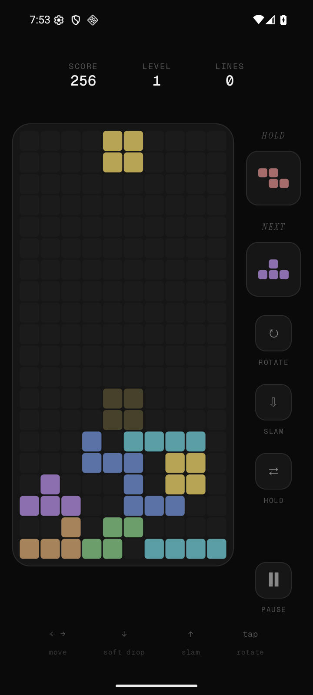
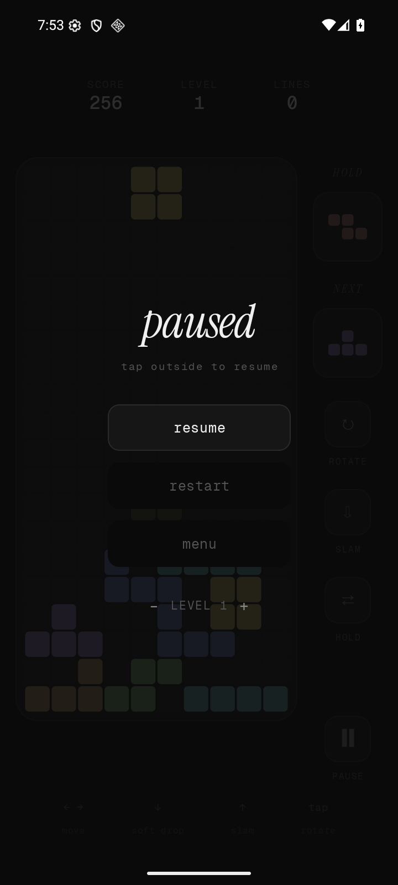
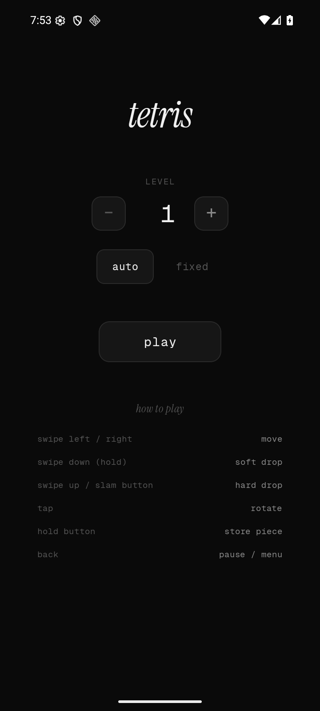

# Tetris Mobile

[](https://kotlinlang.org/)
[](https://developer.android.com/jetpack/compose)
[](https://www.android.com/)
[](LICENSE)

A free, open-source Tetris game for Android, built with Kotlin and Jetpack Compose. A quiet interface for a game I keep coming back to.

> This project is passively maintained.

## Why I built it

I've always been a Tetris addict. It helps me feel calm, but most mobile versions have much louder interfaces than I want. This is my pocket Tetris, with an aesthetic that fits how I play.

## Screenshots

Captured from the Android app on an API 36 emulator. The gameplay board comes from playing normal hold, movement, and hard-drop actions.

| Gameplay | Pause and level controls | Start screen |
| --- | --- | --- |
|  |  |  |

## How to play

- Swipe left or right to move. Hold a horizontal gesture to repeat movement.
- Tap the board or the rotate button to rotate clockwise.
- Swipe down for soft drop. Swipe up or tap slam for an immediate hard drop.
- Use hold to save or swap a piece once per placement.
- Pause to resume, restart, return to the menu, or adjust the level.

The game uses a shuffled seven-piece bag, a landing ghost, one next-piece preview, and basic wall kicks. Choose automatic level progression or a fixed level before starting. Soft drop awards one point per cell; hard drop awards two. Clearing one to four lines awards `40 / 100 / 300 / 1200 × (level + 1)` points. High scores and recent runs are stored locally.

## Stack

Stable dependency versions checked on October 2, 2026.

| Component | Version |
| --- | --- |
| Android Gradle Plugin | 9.4.1, with built-in Kotlin support |
| Kotlin and Compose compiler plugin | 2.4.20 |
| Gradle wrapper | 9.7.0, with distribution checksum verification |
| Compose BOM | 2026.09.00 |
| AndroidX Core | 1.19.1 |
| AndroidX Activity | 1.13.0 |
| AndroidX Lifecycle | 2.11.0 |
| Kotlin Coroutines | 1.11.0 |
| Android SDK | Compile/target 37, minimum 33 |
| Android Build Tools / NDK | 37.0.0 / 30.0.16248370 |

The UI uses Compose. `GameViewModel` exposes a `StateFlow` and schedules gravity through coroutines. Gravity advances at a level-dependent interval; display refresh rate is a separate concern. `GameEngine` handles collisions, placement, line clearing, and scoring in Kotlin. `HighScoreManager` stores scores in SharedPreferences.


## Build and test

Use an Android Studio release that supports AGP 9.4, JDK 21 for the configured Gradle daemon, and Android SDK Platform 37 with Build Tools 37.0.0 and NDK 30.0.16248370. Java/Kotlin bytecode targets Java 17. The app runs on Android 13 and later.

```bash
git clone https://github.com/aaditagrawal/tetris-mobile.git
cd tetris-mobile
```

Set your SDK location in the ignored `local.properties` file, or configure `ANDROID_HOME`. Install the SDK packages if needed:

```bash
android sdk install "platforms;android-37.0" "build-tools;37.0.0" "ndk;30.0.16248370"
./gradlew assembleDebug assembleRelease testDebugUnitTest lintDebug
./gradlew installDebug
```

The debug APK is written to `app/build/outputs/apk/debug/app-debug.apk`. Release builds enable code and resource shrinking; configure release signing before distribution.

For device tests, start an emulator or connect an Android device:

```bash
./gradlew connectedDebugAndroidTest
```

To refresh the screenshots on a portrait emulator, run the gameplay smoke test with capture enabled and copy the resulting PNGs:

```bash
./gradlew installDebug installDebugAndroidTest
adb shell am instrument -w \
  -e class com.maverick.tetris_mobile.GameplaySmokeTest \
  -e screenshots true \
  com.maverick.tetris_mobile.test/androidx.test.runner.AndroidJUnitRunner
adb pull /sdcard/Android/data/com.maverick.tetris_mobile/files/screenshots/. assets/screenshots/
```

## Contributing

See [CONTRIBUTING.md](CONTRIBUTING.md) for project structure and contribution guidance. Run the unit tests and lint before submitting a change. Include gameplay screenshots for UI changes.

## License

[MIT](LICENSE).
